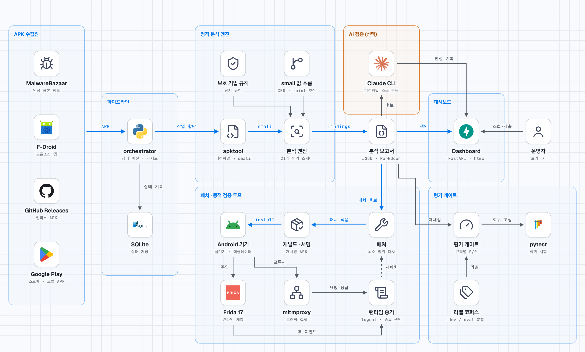
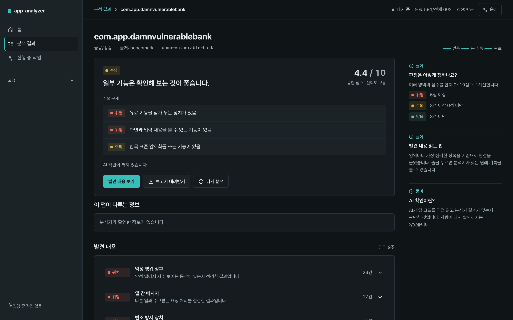
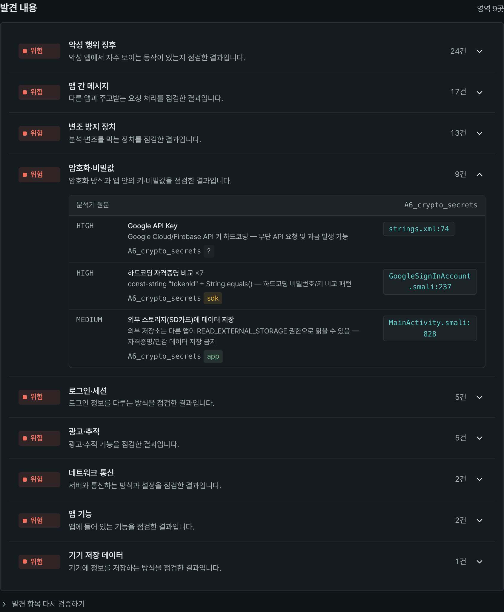
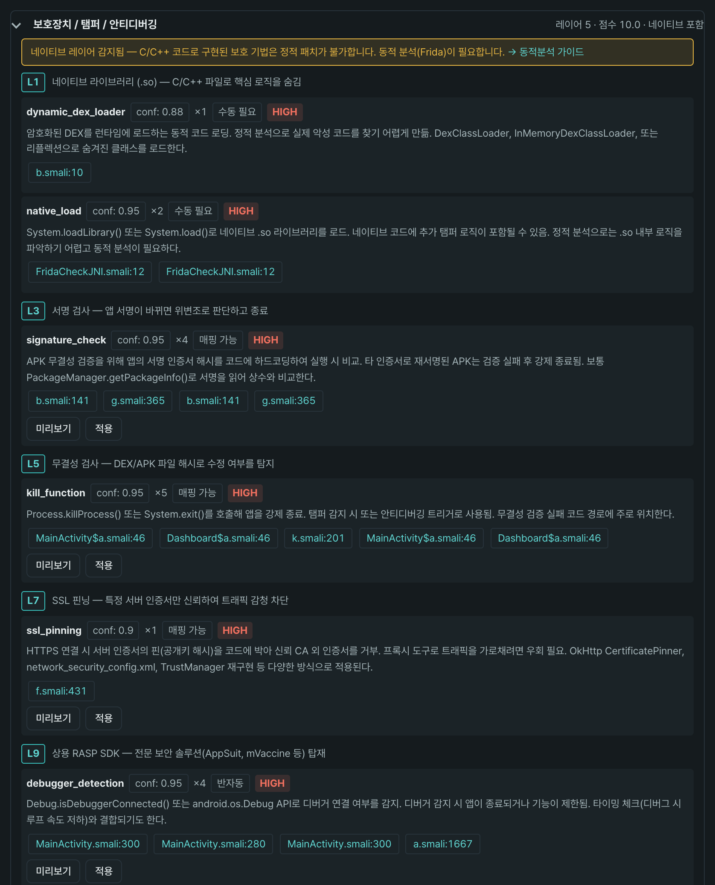
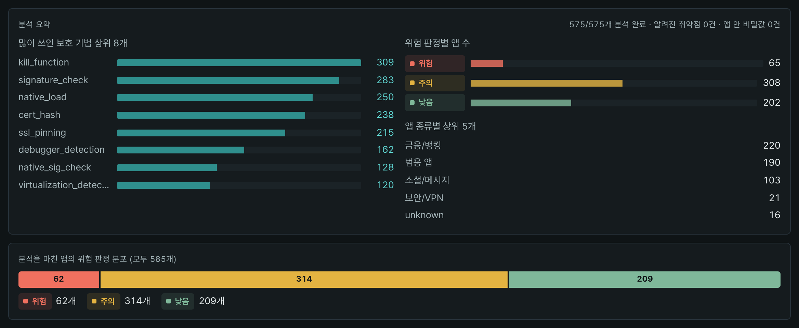

# app-analyzer — Android APK 보안 분석·패치·검증 파이프라인

> 프로젝트 소개용 공개 사본입니다. 소스 코드·탐지 규칙·패치 도구는 비공개 저장소에서 관리합니다.

APK를 넣으면 21개 분석 영역에서 취약점과 보호 기법을 찾아 증거 위치(smali 파일:줄)와 점수를 남기고, 보호 기법은 패치 → 재빌드·서명 → 실기기 검증까지 한 흐름으로 처리하는 개인 보안 연구 파이프라인입니다.

| 항목 | 내용 |
|---|---|
| 문제 | 수백 개 APK를 사람이 하나씩 디컴파일해 보기엔 느리고, 글자 일치 기반 스캐너는 오탐이 많으며, 보호 기법이 걸린 앱은 분석 도구를 붙이는 순간 종료된다 |
| 접근 | 수집부터 분석·패치·런타임 검증까지 상태 머신 하나로 묶고, 탐지는 값의 흐름으로 판정하며, 규칙의 정확도는 사람이 붙인 라벨로 측정한다 |
| 대상 | 본인 소유 기기·계정, 공개 취약 연습 앱(DIVA, Damn Vulnerable Bank 등), 공개 악성 표본 피드 |
| 환경 | macOS(Apple Silicon), Android 실기기·에뮬레이터, Python 3.14 |
| 기간·규모 | 2026-03 ~ 현재, 개인 프로젝트 · Python 약 10만 줄 · 테스트 약 2,600개 |
| 처리 실적 | APK 602개 수집 · 591개 분석 완료 |

## 동작 흐름

<picture>
  <source media="(prefers-color-scheme: dark)" srcset="images/architecture-dark.png">
  
</picture>

1. **수집** — 공개 악성 표본 피드, F-Droid, GitHub Releases, Google Play, 로컬 파일에서 APK를 받아 원본을 읽기 전용으로 보관합니다.
2. **오케스트레이션** — 상태 머신이 표본을 하나씩 처리하고 재시도·실패 원인 분류·복구를 맡습니다.
3. **정적 분석** — 21개 영역 스캐너와 보호 기법 탐지 규칙이 증거 위치와 함께 결과를 남기고, 위험도 높은 항목은 패치 후보가 됩니다.
4. **패치·검증 루프** — 미리보기로 계획을 확인한 뒤 최소 범위만 고치고, 재빌드·서명·설치 후 런타임 기록으로 결과를 확인합니다. 앱이 종료되면 원인을 분류해 다음 수정 위치를 정합니다.
5. **AI 보조 검증(선택)** — AI가 디컴파일 소스를 읽고 탐지 후보를 "맞음/오탐/판단 불가"로 판정합니다. 판정은 별도로 기록하고 점수에 섞지 않습니다.
6. **평가 게이트** — 사람이 판독한 라벨로 규칙별 정밀도·재현율을 재고, 입증된 규칙은 회귀 시험으로 고정합니다.

## 주요 기능

- **정적 분석 21개 영역**: 공격 표면(노출 컴포넌트·Intent·WebView·딥링크), 인증·저장(세션·암호·하드코딩 비밀값·로컬 저장소), 네트워크·공급망(API·SBOM·외부 업데이터), 네이티브·보호 기법, 행위(광고·추적 SDK·악성 행위 징후). 탐지마다 OWASP MASVS/MASTG 태그를 붙입니다.
- **보호 기법 계층 분석**: 서명·무결성 검사, 강제 종료, 루트·디버거·계측 탐지, SSL 피닝, 상용 보안 SDK 탑재 여부를 계층별로 묶고 패치 가능 여부를 표시합니다.
- **패치·검증 루프**: 원본은 건드리지 않고 사본에서만 고치며, 모든 패치는 미리보기부터 시작합니다.
- **동적 분석**: Frida 계측, 트래픽 캡처, WebView 쓰기 요청 차단, 종료 원인 분류.
- **대시보드**: 앱별 판정·증거·패치 후보를 보여 주고 제출·재분석·패치를 버튼으로 실행합니다.

## 차별점

1. **글자가 아니라 값의 흐름으로 판정합니다.** 레지스터 단위 값 흐름 분석으로 데이터가 실제로 위험한 곳에 닿을 때만 탐지합니다.
2. **"나아졌다"를 숫자로 입증합니다.** 라벨 1,435건과 앱 단위 dev/eval 분할로 규칙을 평가하고, 입증된 규칙이 나빠지면 시험이 실패합니다.
3. **증거 없이 결론 내리지 않습니다.** 모든 탐지·패치는 증거 위치로, 모든 런타임 판단은 기기 기록으로 거슬러 올라갈 수 있습니다.

## 성과

| 주제 | 결과 |
|---|---|
| 값 흐름 분석 도입 | SQL 결합 규칙 오탐 53건 → 7건(정탐 손실 0), 암호 모드 오탐 138건 제거 |
| 상용 보호 솔루션 적용 앱 계측 | 상용 보호 솔루션(OO / OO + OO + OO)이 적용돼 계측 즉시 종료되던 앱 2종의 종료 원인을 증거로 분류하고 계측 유지 — 실기기 10회 중 9회 생존 |
| 로그인 뒤 안전 탐색 실험 | 쓰기 요청 통과 0건(20회), 목표 화면 도달: 규칙 기반 탐색 2/8 → AI 제한 탐색 8/8, 찾은 경로는 모델 없이 40/40 재생 |
| 대량 처리 성능 | 큰 앱 자동 검증 136~182초 → 3~7초 |

### 탐지 품질 — 입증 규칙

라벨 기준 수치입니다(dev / eval 분할).

| 규칙 | 정밀도 | 재현율 |
|---|---|---|
| Intent 데이터 → WebView 로드 | 1.00 / 1.00 | 1.00 / 1.00 |
| SQL 직접 결합(rawQuery) | 0.92 / 1.00 | 1.00 / 1.00 |
| 외부 저장소 쓰기 | 0.93 / 1.00 | 1.00 / 1.00 |
| ECB 암호 모드 | 0.96 / 0.82 | 1.00 / 1.00 |
| 그 외 3개(표본 작음) | 1.00 / 1.00 | 1.00 / 1.00 |

## 화면

공개 취약 연습 앱 [Damn Vulnerable Bank](https://github.com/rewanthtammana/Damn-Vulnerable-Bank)를 분석한 실제 결과입니다. 전체 운영 현황은 앱 이름 없이 집계값만 보여 줍니다.

| 앱 판정 요약 | 영역별 발견 내용 |
|---|---|
|  |  |
| **보호 기법 계층 분석** | **전체 운영 현황** |
|  |  |

## 기술 스택

Python · smali 정적 분석(자체 값 흐름 엔진) · apktool · jadx · Frida · mitmproxy · ADB · FastAPI · htmx · SQLite · Claude CLI · pytest

## 연구 범위

본인 소유 기기·계정, 공개 취약 연습 앱, 공개 악성 표본만 대상으로 하는 인가된 개인 연구입니다.

## 현재 상태

운영 중입니다. 탐지 규칙의 정확도를 라벨로 넓혀 가는 중이며, 일부 규칙은 표본이 작아 추가 검증이 필요합니다.
